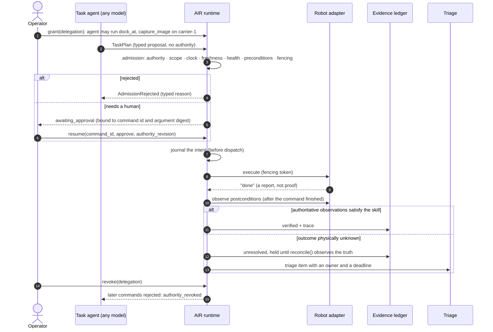
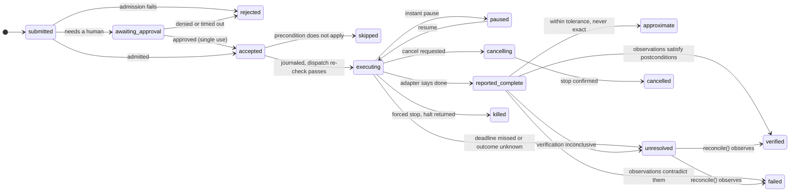
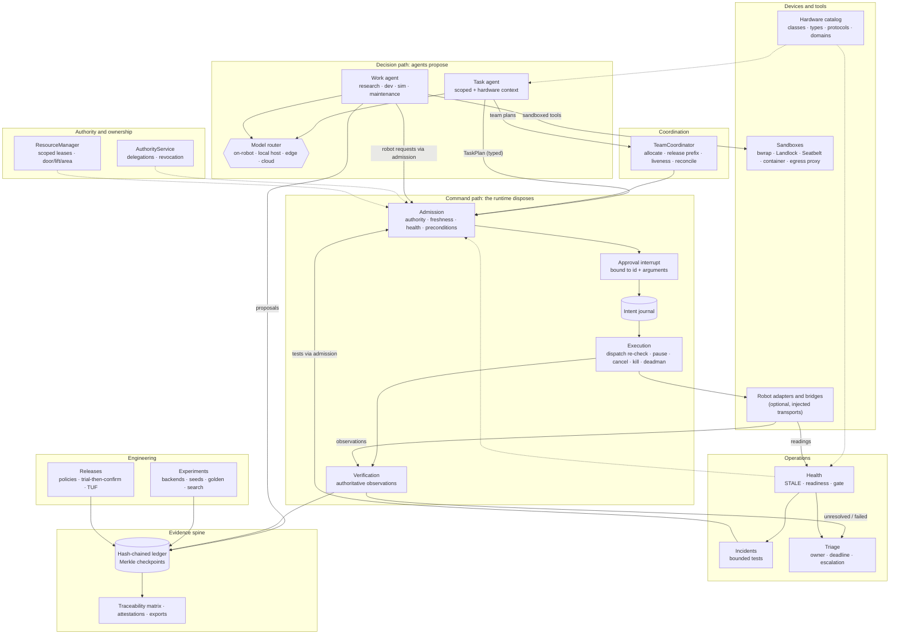

<div align="center">

# AIR

### The runtime between the model and the motors

**A dependency-free Python platform for robots that agents can safely direct, and for
the engineering work around them that agents can safely do.**

Agents propose. The runtime admits, executes and **verifies against observations**.
Everything leaves evidence.

[](LICENSE)


[Why](#why-air) · [What](#what-you-get) · [How](#how-it-works) · [Where](#where-it-fits) ·
[Quickstart](#quickstart) · [Architecture](#architecture) · [Toolbox](#the-air-toolbox) ·
[Status](#status-and-roadmap)

<sub><i>AIR: Artificial Intelligent Robotics. Built from the</i> Agentic Robotics Framework:
Requirements and architecture baseline v0.1 <i>(21 October 2026).</i></sub>

</div>

---

## Why AIR

Language models can now plan robot missions, write code, run simulations and diagnose
faults. Most agent stacks then **hand the model's output straight to the machine**: a
tool call becomes a motor command, and "done" means the robot *said* it was done.

That fails in the ways that matter physically:

| What goes wrong | What it looks like |
|---|---|
| **Authority leaks** | The model, a tool description or retrieved text decides what the robot may do |
| **Reports are trusted** | "Completed" is logged when the gripper actually dropped the part |
| **Retries are blind** | A lost acknowledgement causes a second pick of an already-picked part |
| **Ownership is fuzzy** | Two robots believe they hold the same handoff station |
| **Problems pile up unseen** | An unresolved command, a stale sensor and an expiring lease each log a line, and nobody owns them |
| **Nothing is traceable** | No one can say which model, plan, data, approval or firmware led to an action |

AIR puts a **typed, verifying runtime** in that gap. It applies the same discipline to the
engineering work around robots (research, development, simulation, evaluation,
maintenance, diagnosis) when agents do it.

## What you get

<table>
<tr>
<td width="50%" valign="top">

**🤖 Runtime that never trusts a report**
- Admission: authority, scope, clock quality, input freshness, preconditions, fencing, health
- `verified` only from authoritative observations taken after the command finished; unknown outcomes are `unresolved` and settled by `reconcile()`, never by a blind retry
- A command journal written before dispatch; after a restart nothing is resent
- Human approval as an interrupt bound to the exact arguments; cancel ≠ kill; intent deadman with a declared exit mode

</td>
<td width="50%" valign="top">

**🤝 Multi-robot coordination**
- Propose → bid → allocate → fenced, all-or-nothing leases → commit → verify
- Work released in steps under VDA 5050 order-update rules; a disconnected robot finishes only what was released
- Liveness, per-channel sequence numbers, hybrid logical clocks
- Door, lift, area and mode-switch modules; graded robot trust

</td>
</tr>
<tr>
<td valign="top">

**🧠 Any model, placed deliberately**
- Local open models (Ollama, vLLM, llama.cpp, LM Studio), closed APIs (Claude via the official SDK), or models **hosted on the robot itself**
- A router that chooses by where a model runs and whether data may leave the device; restricted data never reaches a cloud model

</td>
<td valign="top">

**🧪 Agents that do engineering work, in real sandboxes**
- Research, development, simulation, evaluation, maintenance and diagnosis tasks
- bubblewrap, Landlock, Seatbelt, containers, Windows job objects; an egress proxy that denies private and metadata ranges
- Sandboxes **declare what they enforce**; strict mode refuses work they cannot protect
- Command policy rules, risk analysis, single-use approvals; agents deliver **proposals** a different person decides

</td>
</tr>
<tr>
<td valign="top">

**🚨 Triage: one queue for everything that's wrong**
- Runtime outcomes, health, incidents, pending proposals, failed checks and expiring leases become items with an owner and deadlines
- Severity (impact) separate from priority (urgency); repeats fold into one item; escalation chains
- Safety and integrity items can't be silenced, snoozed or closed by an agent

</td>
<td valign="top">

**🔩 Hardware it understands, never requires**
- 100 robot classes, 648 device types, 122 protocols, with units, telemetry limits, maintenance and failure modes
- Links to QUDT, SOSA/SSN, SAREF, LwM2M and Matter; WoT Thing Model and JSON-LD export
- 19 engineering domain packs; a task-context selector that hands agents the facts a job needs, with sources
- Vendor parts extend built-in types; datasheets are pinned by digest

</td>
</tr>
<tr>
<td valign="top">

**🩺 Operations**
- Health from the robot's own parts, with **STALE** as a first-class level; health can restrict what the runtime admits
- A readiness gate before activation, and a diagnosis table
- Incidents with novelty detection, non-authoritative agent hypotheses, and bounded tests that go through admission
- Prognostics with uncertainty, gated on the 5th percentile, not the mean

</td>
<td valign="top">

**🔬 Engineering and optimization loop**
- Experiment backends that must *declare* fidelity, determinism and restore support
- Seed records with single-sample replay; a reproducibility probe (exact / within tolerance / differs)
- Per-platform golden runs that are re-measured, never trusted
- Constrained search with release candidates re-validated on held-out seeds; sim-to-real benchmark validity

</td>
</tr>
<tr>
<td valign="top">

**🚀 Policies and releases**
- Learned policies as content-addressed manifests with a load gate; a failed load keeps the old policy
- Releases stay provisional until they confirm themselves; a security counter blocks downgrades
- TUF-style signed metadata and per-robot director assignments
- Typed parameter sets, dataset episodes (RLDS/LeRobot-like), asset cards, conformance reports

</td>
<td valign="top">

**📜 Evidence you can prove**
- Hash-chained ledger over RFC 8785 canonical JSON, with RFC 9162 Merkle checkpoints and inclusion/consistency proofs
- in-toto attestations for work and test runs; PROV-JSON, OTLP/JSON and StrictDoc exports
- Requirements → code → tests → activities; `air requirements matrix --check` fails when a claim lacks evidence
- Lineage and impact queries; reproducibility locks; recordings registered by sha256

</td>
</tr>
<tr>
<td colspan="2" valign="top">

**🔌 Bridges, all optional**: Microduck · Unitree · AgileX Piper · ROS 2 actions · VDA 5050 · openpi · LeRobot · dora · an **MCP server** whose tool calls are proposals through admission. Every bridge uses an injected transport and is tested against a fake peer that speaks the upstream wire protocol; the core never imports one.

</td>
</tr>
</table>

## How it works

One mission, end to end. The model only ever produces a *typed proposal*. Everything
after that is checked, fenced, journaled, observed and recorded.



The command lifecycle at the centre of the runtime:



## Where it fits

AIR is a **library, framework, tool and platform**, not an application. Product teams
embed it and bring their own robots, models and infrastructure.

| Layer | What it is | Where |
|---|---|---|
| **Library** | Typed, versioned contracts (58 published JSON Schemas) and a local runtime with **zero third-party dependencies** | `core`, `contracts`, `runtime` |
| **Framework** | Extension points: robot adapters, model providers, admission checks, declarative skills, sandboxes, experiment backends, health checks, triage rules, hardware catalogs and domain packs | `plugins`, `agents`, `work`, `engineering`, `health`, `hardware` |
| **Tool** | The `air` CLI: 37 command groups from `validate` to `doctor` | `cli` |
| **Platform** | Content-addressed asset registry for manifests, skills, plans, policies and releases, with signed TUF-style metadata (local today; hosted later, same interface) | `registry`, `releases` |

**AIR never requires particular hardware.** The catalog describes robots; it doesn't
prescribe them. Composition checks are advice unless you pass `--strict`, and nothing in
the runtime needs a catalog entry. See the [hardware catalog](docs/hardware-catalog.md).

**Who it's for**

- **Robot product teams** who want LLM planning without giving the LLM the keys.
- **Fleet and integration engineers** coordinating heterogeneous robots over unreliable links.
- **R&D and test teams** who need every experiment, simulation and model call reproducible and attributable.
- **Operations, maintenance and safety teams** who need health, incidents, component lineage and a queue of what needs a decision.

## Quickstart

AIR uses an isolated Python environment managed by [uv](https://docs.astral.sh/uv/).
Nothing is installed system-wide.

```bash
uv venv --python 3.12 .venv
```

```bash
uv pip install --python .venv -e ".[dev]"
```

Check what your machine offers (optional tools such as bubblewrap or ROS are reported, never required):

```bash
.venv/Scripts/air doctor
```

Run a full plan on a fake robot. No hardware, simulator, model key or network is needed:

```bash
.venv/Scripts/air quickstart
```

```text
granted dlg_quickstart: agent:task may run dock_at, capture_image, navigate_to on carrier-1
plan plan_…: dock_at -> capture_image
  t1 dock_at: verified [docked at requested station=ok]
  t2 capture_image: verified [new image captured=ok]
plan outcome: verified
after revocation, a new command is rejected: authority_revoked
```

Then run a two-robot mission: a carrier brings a part to a shared handoff station, and
an arm picks and inspects it. The `disconnect` variant shows a robot losing its link
mid-mission and finishing only the work already released to it:

```bash
.venv/Scripts/air scenario handoff
```

```bash
.venv/Scripts/air scenario handoff --variant disconnect
```

Ask for the hardware facts behind a symptom on the example AMR:

```bash
.venv/Scripts/air hardware context examples/robots/amr.manifest.json --text "left wheel overheating"
```

On Linux and macOS use `.venv/bin/` instead of `.venv/Scripts/`. A container definition
(`Dockerfile`, `.devcontainer/`) runs the same toolchain.

### In code

```python
from agentic_robotics import Robot, Runtime, SkillRegistry, TaskAgent, PlanExecutor

runtime = Runtime(skills, root_principals=["operator:alice"])
robot = runtime.register(Robot.from_manifest(manifest))

async with runtime:
    grant = runtime.authority.grant(delegation)              # bounded, revocable authority
    plan = await TaskAgent(model, skills, runtime.clock).plan("inspect the part", [robot])
    result = await PlanExecutor(runtime).submit(
        plan, principal="agent:task", delegation_id=grant.delegation_id).wait()
    print(result.state)                                      # verified, failed or unresolved
```

A complete, runnable version is in [`quickstart.py`](src/agentic_robotics/quickstart.py).
To connect your own hardware, see [`examples/custom_adapter.py`](examples/custom_adapter.py)
and the bridges in [`integrations/`](src/agentic_robotics/integrations/).

### Agents doing engineering work

```python
router = ModelRouter()
router.register(OpenAICompatibleProvider(ModelProfile(
    name="workstation", provider="openai_compatible", model="qwen2.5:14b",
    location=Location.LOCAL_HOST, data_leaves_device=False,
    endpoint="http://localhost:11434/v1")))                      # Ollama on this machine

result = await WorkAgent(project, router).run(WorkTask(
    task_id="sim-1", kind=WorkKind.SIMULATION, requirements=("REQ06",),
    goal="Run the handoff scenario and report whether every task verifies",
    data_classification=DataClass.INTERNAL))     # restricted data never reaches cloud models
```

```bash
.venv/Scripts/air work run examples/work/handoff-simulation.task.json
```

```bash
.venv/Scripts/air work decide <proposal-id> approve --by engineer:sam
```

Optional extras, each imported lazily: `anthropic` (Claude), `optuna` (search),
`signing` (Ed25519), and one per bridge (`piper`, `vda5050`, `openpi`, `lerobot`, `dora`).
Install them with `uv pip install --python .venv -e ".[anthropic]"` and so on.

## Architecture



**Package dependency rule:** `core` depends on nothing. `contracts` depend on `core`.
`runtime`, `agents`, `provenance`, `hardware`, `engineering`, `health` and the other
subsystems depend on `contracts` and `core`. `integrations` and `mcp` use only public
protocols, and nothing in the core imports a bridge. See
[docs/architecture.md](docs/architecture.md) for the full mapping onto the baseline and
[docs/decisions/](docs/decisions/) for the 19 ADRs behind it.

### Design principles

1. **Agents propose; the runtime disposes.** Model output, tool descriptions and retrieved text never grant authority.
2. **Never trust a report.** Completion is verified from authoritative observations. Unknown physical outcomes are unresolved.
3. **Never resend a physical action blindly.** Intents are journaled; retries are explicit decisions.
4. **Fail closed.** An expired lease on an occupied resource keeps blocking. A sandbox that can't enforce the policy refuses the work. A silent sensor is STALE, never OK.
5. **Describe hardware; never require it.** Composition checks are advice; adapters and bridges are optional.
6. **Contracts are strict and versioned.** Unknown fields fail loudly; changes follow [the versioning policy](docs/policy/versioning.md).
7. **Everything significant leaves evidence**, and the evidence can be proven: one trace, one ledger, Merkle checkpoints.

## The `air` toolbox

<details open>
<summary><b>Get started</b></summary>

| Task | Command |
|---|---|
| Check the environment and optional tools (never raises) | `air doctor` |
| Run the fake-robot quickstart | `air quickstart` |
| Run the two-robot handoff, or its disconnect and cancel variants | `air scenario handoff [--variant disconnect\|cancel]` |
| Validate any contract document | `air validate examples/robots/carrier.manifest.json` |
| List contract schemas; check them for drift and compatibility | `air schemas` · `air schema check` |
| Check an adapter against the protocol; write a versioned report | `air conformance <manifest.json> --skills <skills.json> [--out report.json]` |

</details>

<details>
<summary><b>Evidence, provenance and traceability</b></summary>

| Task | Command |
|---|---|
| Start a provenance project | `air init --baseline` |
| Record research, simulation, maintenance and other activities | `air activity record --kind simulation …` |
| Verify the ledger; detect truncation or rewrite since a checkpoint | `air ledger verify [--since latest]` |
| Checkpoint the ledger (Merkle root, optionally signed); prove one entry | `air ledger checkpoint` · `air ledger prove 42` |
| in-toto attestations of a work run or a test run | `air attest work <activity-id>` · `air attest tests` |
| Export provenance, traces, requirements | `air export prov` · `air export otel --endpoint http://localhost:4318` · `air export sdoc` |
| Register a recording (MCAP, run log, any file) with its sha256 | `air recording register run.mcap --activity <id>` |
| Lock inputs and environment; what changed since? | `air repro lock` · `air repro --check` |
| Explain why a command failed | `air trace explain <command-id>` |
| Where did this artifact come from? What depends on it? | `air lineage <file-or-entity>` · `air impact <entity>` |
| Record maintenance with component lineage | `air maintenance record --robot … --replace OLD=NEW` |
| Requirements matrix (fails on missing evidence) | `air requirements matrix --check` |
| Briefing for people and agents | `air context --out docs/CONTEXT.md` |
| Query a catalog of studied open-source projects (kept locally) | `air sources list --priority P0 -v` |

</details>

<details>
<summary><b>Agent work, sandboxes and models</b></summary>

| Task | Command |
|---|---|
| Run agent work in a sandbox | `air work run task.json [--approve robot]` |
| Run unattended (every approval ask becomes a deny) | `air work run task.json --unattended` |
| List proposals; approve or reject one | `air work proposals` · `air work decide <id> approve --by engineer:sam` |
| Check a command against the agent command policy | `air work rules check -- git push` · `air work rules validate rules.json` |
| What each sandbox adapter enforces on this host | `air sandbox probe [--policy policy.json]` |
| Show the bwrap / landrun / Seatbelt command a sandbox would run | `air sandbox preview --adapter bubblewrap -- python job.py` |
| List declared models | `air models` |
| Serve AIR skills to MCP clients as proposals | `air mcp serve --skills skills.json --manifest robot.json --allow navigate_to` |

</details>

<details>
<summary><b>Triage, health, incidents and prognostics</b></summary>

| Task | Command |
|---|---|
| See everything that needs a decision, most severe first | `air triage sweep` then `air triage list --overdue` |
| Acknowledge, assign or close an item | `air triage ack <id> --by …` · `air triage resolve <id> --by … --reason … --evidence ledger:<seq>` |
| Expected health items for a robot, from the catalog | `air health derive robot.manifest.json --out health.json` |
| Aggregate readings (ERROR/STALE exit 1, optionally into triage) | `air health check health.json --readings r.json --triage` |
| Readiness before activating a mode | `air health ready robot.manifest.json --readings r.json --mode autonomous` |
| Host pressure (Linux PSI) and the diagnosis table | `air health psi` · `air health diagnosis --exercise` |
| Open, investigate, hand off and close incidents | `air incident open --robot … --signal …` · `air incident list` · `air incident close <id> --by … --resolution …` |
| Time-to-event with uncertainty, gated on p5 | `air prognose estimate --series soh.csv --threshold 80 --robot … --component … --signal … --mission 8h` |

</details>

<details>
<summary><b>Hardware catalog and context</b></summary>

| Task | Command |
|---|---|
| Find device types, robot classes, protocols | `air hardware types lidar` · `air hardware classes` · `air hardware protocols` |
| Check a robot manifest against the catalog | `air hardware check robot.manifest.json [--strict]` |
| Monitoring limits and maintenance for a robot | `air hardware plan robot.manifest.json` |
| Start a manifest for a robot class | `air hardware template robot.legged.quadruped` |
| Hardware facts for a task, ranked and sourced | `air hardware context robot.manifest.json --text "left wheel overheating"` |
| Domain briefing (D01–D19) for agents and people | `air hardware brief D02 D14` |
| Pin a datasheet to a component | `air hardware attach robot.manifest.json wheel-left sheet.pdf` |
| Export as W3C WoT Thing Model or JSON-LD | `air hardware export sensor.imu.mems_6axis` |

</details>

<details>
<summary><b>Experiments, policies and releases</b></summary>

| Task | Command |
|---|---|
| Run a seeded experiment and record it | `air experiment run --config kp=4 --seed 7 --episodes 3 --record` |
| Measure reproducibility (exact / within tolerance / differs) | `air experiment probe --backend pointmass` |
| Record and re-check per-platform golden runs | `air experiment golden record --name settle` · `air experiment golden check` |
| Constrained search with held-out release selection | `air experiment search --param kp=0.5:8 --objective energy --constraint overshoot<=0.2 --held-out 11,12 --record` |
| Sim-to-real validity of a benchmark; invalidate a result | `air experiment validity --benchmark … --sim a=0.8 --real a=0.7 …` · `air experiment invalidate <id> --by … --reason …` |
| Check a learned policy's sidecar against a robot slot's load gate | `air policy check walk.policy.json --model walk.onnx --requires slot.json` |
| Publish a policy (sidecar + model bytes) to the registry | `air policy publish walk.policy.json walk.onnx` |
| Trial-then-confirm a release (reverts unless confirmed) | `air release stage rel.json --robot … --slot … --state s.json` · `air release boot …` · `air release confirm --check health=pass …` |
| TUF targets metadata over registry assets; check an asset card | `air release targets --root .ar-registry` · `air release card walk.card.json --strict` |
| Validate or diff typed parameter sets | `air params validate schema.json set.json` · `air params diff schema.json old.json new.json` |
| Convert an episode to RLDS-like or LeRobot-like JSON | `air dataset convert ep.json --to lerobot` |

</details>

Every command has `--help`.

## Status and roadmap

All APIs are experimental (`0.x`) until they pass their acceptance gates in the baseline.

| Stage | Scope | State |
|---|---|---|
| 1 | Contracts and developer foundation | ✅ done |
| 2 | One-robot execution path: admission, verification, reconciliation | ✅ done |
| 3 | Two-robot coordination and handoff | ✅ done |
| + | Evidence spine: ledger v2, tracing, traceability, context feeder | ✅ done |
| + | Agentic engineering work: sandboxes, model router, proposals | ✅ first version |
| + | Triage and hardware catalog with semantic, domain and task context | ✅ first version |
| 2b | Commitment semantics: intent journal, approval interrupts, cancel vs kill, deadman, coordination liveness | ✅ first version |
| 4 | Engineering and optimization loop: experiment backends, seeds, golden runs, search, eval validity | ✅ first version (reference backend only; no real simulator adapters yet) |
| 5 | Operations: health, readiness, incidents, prognostics | ✅ first version (takeover and handback still to do) |
| 6 | Ecosystem: bridges (Microduck, Unitree, Piper, ROS 2, VDA 5050, openpi, dora), MCP server | 🔧 in progress (tested against fake peers; not yet run on real robots or stacks; no hosted registry) |

**Quality bar for every change:** tests (`pytest`, 700+), lint (`ruff`), strict typing
(`mypy`), the traceability matrix check, and the schema drift and compatibility check.
CI runs all of them. This repository records its own development in its `.air/` ledger,
with Merkle checkpoints in `.air/checkpoints/`. Maturity is stated honestly in the
[quality declaration](QUALITY_DECLARATION.md).

## Repository map

```text
src/agentic_robotics/
├── core/          ids · contract base · units and frames · clocks · errors · JSON Schema
├── contracts/     manifests · capabilities · observations · skills · execution · authority · resources
│                  · policies · releases · parameters · datasets
├── runtime/       admission · authority · fenced resources · journal · holds · execution · plans · trace
├── coordination/  protocol · transport · allocation · orders · liveness · HLC · team coordinator
├── agents/        context selection · task agent · providers/ (OpenAI-compatible, Anthropic, router)
├── work/          sandboxes · egress proxy · command policy · risk · approvals · tools · work agent
├── provenance/    tracing · ledger · Merkle checkpoints · attestations · exports · traceability · context pack
├── triage/        contracts · policy (rules, silences, inhibitions) · book · collectors
├── hardware/      catalog (100 classes · 648 types · 122 protocols) · semantics · domain packs · task context
├── engineering/   experiment backends · seeds · reproducibility probe · golden runs · search · validity
├── releases/      policy slots · trial-then-confirm activation · TUF metadata · signing
├── health/        expected items · STALE · rollup · monitors · PSI · capability gate · readiness · diagnosis
├── incidents/     detection · novelty · hypotheses · bounded tests through admission · recovery or handoff
├── maintenance/   prognostics: time-of-event distributions, censoring, gating on p5
├── integrations/  fake carrier and arm · bridges: microduck · unitree · piper · ros2 · vda5050 · openpi · lerobot · dora
├── mcp/           MCP server: AIR skills as proposals over stdio
└── testing/       pytest evidence and attestation plugin
schemas/           published JSON Schemas for every contract
examples/          robots (AMR, quadruped, quadcopter, cobot, …) · skills · missions · policies · models · work
docs/              architecture · hardware catalog · decisions (ADRs 0001–0019) · policy · CONTEXT.md
changelog.d/       news fragments for the next release (towncrier)
```

## Contributing

Read [CLAUDE.md](CLAUDE.md) for the rules that keep the architecture honest. These apply
to people and AI agents alike; agents start from [AGENTS.md](AGENTS.md). Decisions are
recorded as ADRs in [docs/decisions/](docs/decisions/). Add a news fragment to
[changelog.d/](changelog.d/) for user-visible changes. Report security issues privately
as described in [SECURITY.md](SECURITY.md).

## License

[GNU Affero General Public License v3.0](LICENSE). See
[ADR 0004](docs/decisions/0004-agpl-license.md) for the reasoning.
