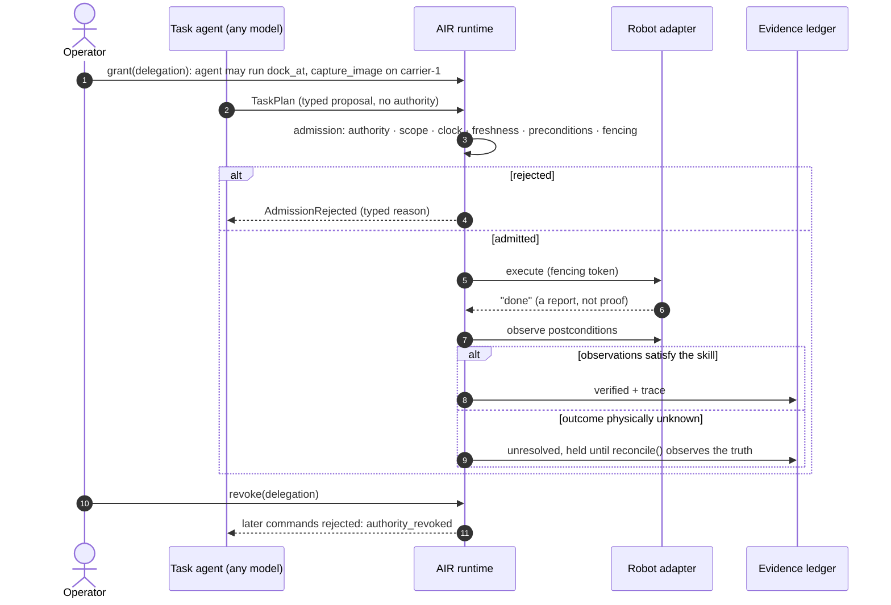
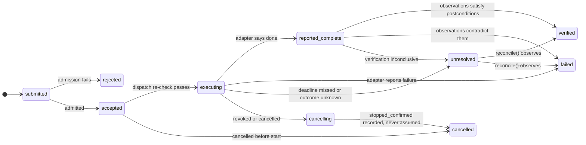
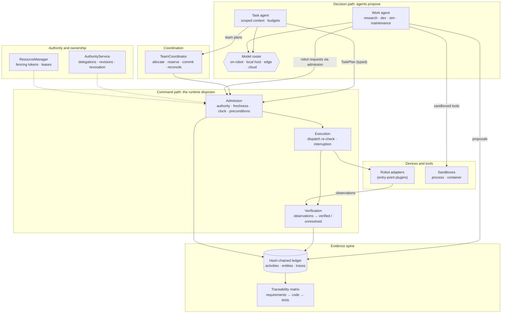

<div align="center">

# AIR

### The runtime between the model and the motors

**A dependency-free Python framework for robots that agents can safely direct, and for
engineering work that agents can safely do.**

Agents propose. The runtime admits, executes and **verifies against observations**.
Everything leaves evidence.

[](LICENSE)


[Why](#why-air) · [What](#what-you-get) · [How](#how-it-works) · [Where](#where-it-fits) ·
[Quickstart](#quickstart) · [Architecture](#architecture) · [Status](#status-and-roadmap)

<sub><i>AIR: Artificial Intelligent Robotics. Built from the</i> Agentic Robotics Framework:
Requirements and architecture baseline v0.1 <i>(21 October 2026).</i></sub>

</div>

---

## Why AIR

Language models can now plan robot missions, write code, run simulations and diagnose
faults. Most agent stacks then **hand the model's output straight to the machine**: a
tool call becomes a motor command, and "done" means the robot *said* it was done.

That fails in the ways that matter physically:

| What goes wrong | What it looks like |
|---|---|
| **Authority leaks** | The model, a tool description or retrieved text decides what the robot may do |
| **Reports are trusted** | "Completed" is logged when the gripper actually dropped the part |
| **Retries are blind** | A lost acknowledgement causes a second pick of an already-picked part |
| **Ownership is fuzzy** | Two robots believe they hold the same handoff station |
| **Nothing is traceable** | No one can say which model, plan, data or approval led to an action |

AIR puts a **typed, verifying runtime** in that gap. It also applies the same discipline
to the engineering work around robots (research, development, simulation, maintenance)
when agents do it.

## What you get

<table>
<tr>
<td width="50%" valign="top">

**🤖 Agentic robotics runtime**
- Admission pipeline: authority, scope, clock quality, input freshness, preconditions, fencing
- `verified` only from observations; unknown physical outcomes are `unresolved` and settled by `reconcile()`, never by a blind retry
- Bounded, revocable delegations; revocation interrupts running work

</td>
<td width="50%" valign="top">

**🤝 Multi-robot coordination**
- Propose → bid → allocate → fenced, all-or-nothing reservations → commit → verify
- Task revisions; late replies for stale revisions are ignored
- Lost results are reconciled by querying the robot, never by re-dispatching

</td>
</tr>
<tr>
<td valign="top">

**🧠 Any model, placed deliberately**
- Local open models (Ollama, vLLM, llama.cpp, LM Studio), closed APIs (Claude via the official SDK), or models **hosted on the robot itself**
- A router that chooses by where a model runs and whether data may leave the device

</td>
<td valign="top">

**🧪 Agents that do engineering work**
- Research, development, simulation, evaluation, maintenance and diagnosis tasks
- Sandboxes that **declare what they enforce**; work that needs more is refused
- Agents deliver **proposals**; a different, authorized person decides

</td>
</tr>
<tr>
<td valign="top">

**📜 Evidence spine**
- Hash-chained ledger over RFC 8785 canonical JSON; `air ledger verify`
- W3C trace ids linking decision → plan → command → verification
- Lineage and impact queries over a PROV-style graph

</td>
<td valign="top">

**✅ Requirements traceability**
- Requirements → code (`__requirements__`) → tests (`@pytest.mark.req`) → activities
- `air requirements matrix --check` fails when a claim lacks evidence
- Evidence goes **stale** when its requirement changes

</td>
</tr>
</table>

## How it works

One mission, end to end. The model only ever produces a *typed proposal*. Everything
after that is checked, fenced, observed and recorded.



The command lifecycle at the centre of the runtime:



## Where it fits

AIR is a **library, framework, tool and platform**, not an application. Product teams
embed it and bring their own robots, models and infrastructure.

| Layer | What it is | Where |
|---|---|---|
| **Library** | Typed, versioned contracts and a local runtime with **zero third-party dependencies** | `core`, `contracts`, `runtime` |
| **Framework** | Extension points: robot adapters (entry points), model providers, admission checks, declarative skills, sandboxes | `plugins`, `agents`, `work` |
| **Tool** | The `air` CLI: validate, conformance, scenarios, ledger, traces, requirements, work, models | `cli` |
| **Platform** | Content-addressed asset registry for manifests, skills, plans and policies (local today; hosted later, same interface) | `registry` |

**What hardware it knows.** A typed [hardware catalog](docs/hardware-catalog.md) ships
in the package:
- **100 robot classes:** industrial arms and cobots, AGVs and AMRs, quadrupeds,
  humanoids and exoskeletons, multirotor and fixed-wing UAVs, USVs, ROVs and AUVs, and
  agricultural, construction, medical, cleaning and inspection robots.
- **648 device types:** motors, joint modules, hydraulics and pneumatics, drives,
  gearboxes, encoders, IMUs, lidar, radar, cameras, F/T and tactile sensors, batteries
  and BMS, compute, radios, IoT sensors and meters, docks, doors and elevators,
  grippers, HMIs, and safety devices.
- **122 protocols:** from PWM, CAN and EtherCAT to MQTT, Matter, OPC UA, ROS 2 and
  VDA 5050.

Each device type has typed properties with units, interfaces, telemetry limits,
maintenance items and failure modes. Links to QUDT, SOSA/SSN, SAREF, LwM2M and Matter
give the data a meaning other systems share. 19 domain packs (D01–D19) hold engineering
invariants, failure taxonomies and rules. A task-context selector hands agents the
facts a job needs, each with its source, and withholds restricted data from cloud
models. Projects add vendor parts that extend built-in types, per-unit limits and pinned
datasheets.

The catalog **describes** hardware; it never requires it. Composition checks are advice
unless you pass `--strict`.

**Who it's for**

- **Robot product teams** who want LLM planning without giving the LLM the keys.
- **Fleet and integration engineers** coordinating heterogeneous robots over unreliable links.
- **R&D and test teams** who need every experiment, simulation and model call reproducible and attributable.
- **Maintenance and safety teams** who need component lineage, calibration state and incident evidence.

## Quickstart

AIR uses an isolated Python environment managed by [uv](https://docs.astral.sh/uv/).
Nothing is installed system-wide.

```bash
uv venv --python 3.12 .venv
```

```bash
uv pip install --python .venv -e ".[dev]"
```

Run a full plan on a fake robot. No hardware, simulator, model key or network is needed:

```bash
.venv/Scripts/air quickstart
```

```text
granted dlg_quickstart: agent:task may run dock_at, capture_image, navigate_to on carrier-1
plan plan_…: dock_at -> capture_image
  t1 dock_at: verified [docked at requested station=ok]
  t2 capture_image: verified [new image captured=ok]
plan outcome: verified
after revocation, a new command is rejected: authority_revoked
```

Then run a two-robot mission: a carrier brings a part to a shared handoff station, and an arm picks and inspects it:

```bash
.venv/Scripts/air scenario handoff
```

On Linux and macOS use `.venv/bin/` instead of `.venv/Scripts/`. A container definition
(`Dockerfile`, `.devcontainer/`) runs the same toolchain.

### In code

```python
from agentic_robotics import Robot, Runtime, SkillRegistry, TaskAgent, PlanExecutor

runtime = Runtime(skills, root_principals=["operator:alice"])
robot = runtime.register(Robot.from_manifest(manifest))

async with runtime:
    grant = runtime.authority.grant(delegation)              # bounded, revocable authority
    plan = await TaskAgent(model, skills, runtime.clock).plan("inspect the part", [robot])
    result = await PlanExecutor(runtime).submit(
        plan, principal="agent:task", delegation_id=grant.delegation_id).wait()
    print(result.state)                                      # verified, failed or unresolved
```

A complete, runnable version is in [`quickstart.py`](src/agentic_robotics/quickstart.py).
To connect your own hardware, see [`examples/custom_adapter.py`](examples/custom_adapter.py).

### Agents doing engineering work

```python
router = ModelRouter()
router.register(OpenAICompatibleProvider(ModelProfile(
    name="workstation", provider="openai_compatible", model="qwen2.5:14b",
    location=Location.LOCAL_HOST, data_leaves_device=False,
    endpoint="http://localhost:11434/v1")))                      # Ollama on this machine

result = await WorkAgent(project, router).run(WorkTask(
    task_id="sim-1", kind=WorkKind.SIMULATION, requirements=("REQ06",),
    goal="Run the handoff scenario and report whether every task verifies",
    data_classification=DataClass.INTERNAL))     # restricted data never reaches cloud models
```

```bash
.venv/Scripts/air work run examples/work/handoff-simulation.task.json
```

```bash
.venv/Scripts/air work decide <proposal-id> approve --by engineer:sam
```

Claude support is an optional extra: `pip install agentic-robotics[anthropic]`. Declare
models in `.air/models.json` and list them with `air models`.

## Architecture



**Package dependency rule:** `core` depends on nothing. `contracts` depend on `core`.
`runtime`, `agents` and `provenance` depend on `contracts` and `core`. `integrations`
use only public protocols, and nothing in the core imports an integration. See
[docs/architecture.md](docs/architecture.md) for the full mapping onto the baseline.

### Design principles

1. **Agents propose; the runtime disposes.** Model output, tool descriptions and retrieved text never grant authority.
2. **Never trust a report.** Completion is verified from observations. Unknown physical outcomes are unresolved.
3. **Contracts are strict and versioned.** Unknown fields fail loudly; changes follow [the versioning policy](docs/policy/versioning.md).
4. **Fail closed.** An expired lease on an occupied resource keeps blocking. A sandbox that can't enforce what the policy requires refuses the work.
5. **Everything significant leaves evidence.** Every decision, approval, model call and outcome lands on one trace.

## The `air` toolbox

| Task | Command |
|---|---|
| Validate any contract document | `air validate examples/robots/carrier.manifest.json` |
| Check an adapter against the protocol | `air conformance <manifest.json> --skills <skills.json>` |
| Start a provenance project | `air init --baseline` |
| Record research, simulation, maintenance and other activities | `air activity record --kind simulation …` |
| Verify ledger integrity | `air ledger verify` |
| Checkpoint the ledger (Merkle root, optionally signed); prove one entry | `air ledger checkpoint` · `air ledger prove 42` |
| Detect ledger truncation or rewrite since a checkpoint | `air ledger verify --since latest` |
| in-toto attestations of a work run or a test run | `air attest work <activity-id>` · `air attest tests` |
| Export provenance, traces, requirements | `air export prov` · `air export otel --endpoint http://localhost:4318` · `air export sdoc` |
| Register a recording (MCAP, run log, any file) with its sha256 | `air recording register run.mcap --activity <id>` |
| Lock inputs and environment; what changed since? | `air repro lock` · `air repro --check` |
| Explain why a command failed | `air trace explain <command-id>` |
| Where did this artifact come from? | `air lineage <file-or-entity>` |
| What depends on it? | `air impact <entity>` |
| Record maintenance with lineage | `air maintenance record --robot … --replace OLD=NEW` |
| Requirements matrix (fails on missing evidence) | `air requirements matrix --check` |
| Briefing for people and agents | `air context --out docs/CONTEXT.md` |
| Run agent work in a sandbox | `air work run task.json [--approve robot]` |
| See everything that needs a decision, most severe first | `air triage sweep` then `air triage list --overdue` |
| Acknowledge, assign or close an item | `air triage ack <id> --by …`, `air triage resolve <id> --by … --reason … --evidence ledger:<seq>` |
| List declared models | `air models` |
| Query a catalog of studied open-source projects | `air sources list --priority P0 -v` |
| Find device types, robot classes, protocols | `air hardware types lidar` · `air hardware classes` · `air hardware protocols` |
| Check a robot manifest against the catalog | `air hardware check robot.manifest.json --strict` |
| Monitoring limits and maintenance for a robot | `air hardware plan robot.manifest.json` |
| Start a manifest for a robot class | `air hardware template robot.legged.quadruped` |
| Hardware facts for a task, ranked and sourced | `air hardware context robot.manifest.json --text "left wheel overheating"` |
| Domain briefing (D01–D19) for agents and people | `air hardware brief D02 D14` |
| Pin a datasheet to a component | `air hardware attach robot.manifest.json wheel-left sheet.pdf` |
| Export as W3C WoT Thing Model or JSON-LD | `air hardware export sensor.imu.mems_6axis` |

## Status and roadmap

All APIs are experimental (`0.x`) until they pass their acceptance gates in the baseline.

| Stage | Scope | State |
|---|---|---|
| 1 | Contracts and developer foundation | ✅ done |
| 2 | One-robot execution path: admission, verification, reconciliation | ✅ done |
| 3 | Two-robot coordination and handoff | ✅ done |
| + | Evidence spine: ledger v2, tracing, traceability, context feeder | ✅ done |
| + | Agentic engineering work: sandboxes, model router, proposals | ✅ first version |
| Next | Commitment semantics: intent journal, cancellation, approval interrupts, deadman | 🔜 next |
| 4 | Engineering and optimization loop: experiment backends, seeds, search | 📋 planned |
| 5 | Operations: health, incidents, prognostics, takeover and handback | 📋 planned |
| 6 | Ecosystem: a second, materially different integration; hosted registry | 📋 planned |

**Quality bar for every change:** tests (`pytest`), lint (`ruff`), strict typing (`mypy`),
the traceability matrix check, and the schema drift and compatibility check. CI runs all
of them. This repository records its own development in its `.air/` ledger.

## Repository map

```text
src/agentic_robotics/
├── core/          ids · contract base · units and frames · clocks · errors · JSON Schema
├── contracts/     manifests · capabilities · observations · skills · execution · authority · resources
├── runtime/       admission · authority · fenced resources · execution · plans · trace
├── coordination/  protocol · transport · allocation · team coordinator
├── agents/        context selection · task agent · providers/ (OpenAI-compatible, Anthropic, router)
├── work/          sandboxes · work contracts · guarded tools · work agent · proposals
├── provenance/    tracing · ledger · project · traceability · explain · context pack · sources
├── hardware/      device catalog: 100 robot classes · 648 device types · 122 protocols · manifest checks
├── integrations/  fake carrier and arm (reference adapters)
└── testing/       pytest evidence plugin
schemas/           published JSON Schemas for every contract
examples/          robots · skills · missions · policies · models · work tasks
docs/              architecture · decisions (ADRs) · policy · CONTEXT.md
```

## Contributing

Read [CLAUDE.md](CLAUDE.md) for the rules that keep the architecture honest. These apply
to people and AI agents alike. Decisions are recorded as ADRs in
[docs/decisions/](docs/decisions/). Report security issues privately as described in
[SECURITY.md](SECURITY.md).

## License

[GNU Affero General Public License v3.0](LICENSE). See
[ADR 0004](docs/decisions/0004-agpl-license.md) for the reasoning.
